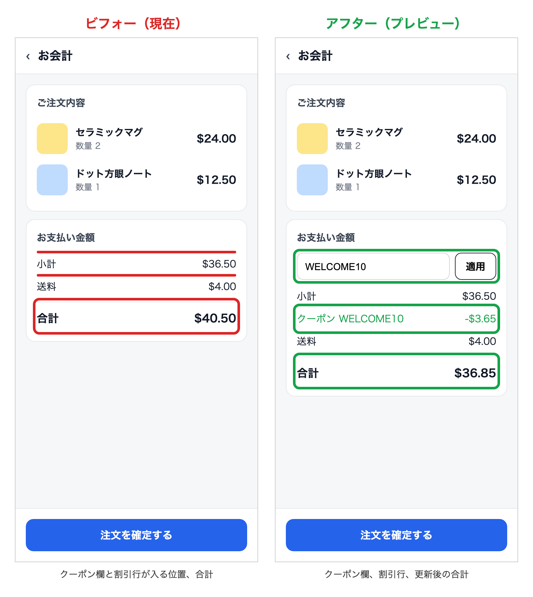
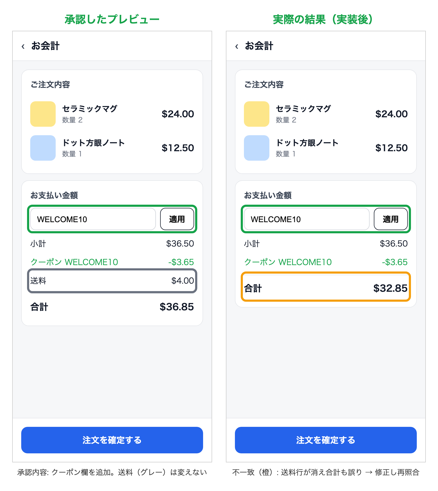
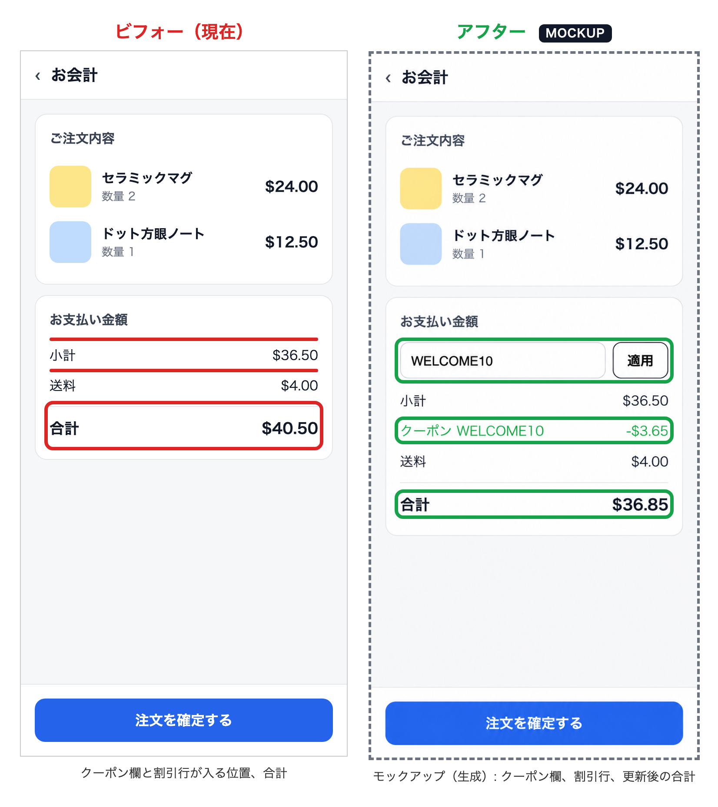

# ui-preview-gate

[English](README.md) | [한국어](README.ko.md) | **日本語**

画面の変更を、実際のビフォー/アフター画像で承認させるエージェントスキルです。

AIエージェントでプロダクトを作っていると、文章だけでは答えがつかみにくい問いが2つあります。

- **「で、何をどう変えるの？」** - コードを書く前に
- **「で、何がどう変わったの？」** - 「完了しました」と言われた後に

長い説明やdiffだけでは、画面を頭の中で想像するしかありません。このスキルは、エージェントに
どちらの問いにも画像で答えさせます。作る前に実際の画面の上で変更を見せ、作った後は
承認した内容どおりになっていることを示させます。

多くのビフォー/アフター系スキルは、変更が終わった後の記録（PR用スクリーンショット）を残す
ものです。このスキルはゲートです。プレビューを実装の*前に*承認し、結果を実装の*後に*
その承認案と照合します。



## 4つのフェーズ

1. **現状確認** - 起動中のアプリで今の画面をキャプチャし、コードの位置（`file:line`）を示します。
   記憶に頼って提案しません。
2. **プレビューと承認** - 左右に並べた画像1枚（ビフォー **赤**、アフター **緑**、既定はモバイル
   375px）と短い要約（どこに出るか、何ができるようになるか、変わらないもの、影響する画面）を
   見せます。明示的なOKをもらってから実装します。
3. **実装** - 承認されたプレビューどおりに作ります。見た目が変わる場合はフェーズ2に戻ります。
4. **結果の照合** - 同じ設定で再キャプチャし、承認案と実際の結果を比べます。約束した変更は緑の
   まま残し、想定外の差分は **オレンジ** の枠で示します。



この例では、クーポンコード欄は入りましたが、変わってはいけない送料の行が消え、合計金額が
間違っています。フェーズ4が「完了」報告の前にそれを見つけます。

意図した画面が変わらないバグ修正はフェーズ2を省きますが、ユーザーに見える差があれば
ビフォー/アフター画像を添えて報告します。

## 画像ポリシー

既定（`real-only`）では、両側とも実際のアプリの全画面キャプチャでなければなりません。切り抜いた
一部、描き直したり生成したりしたモックアップ、架空のデータは使いません。ユーザーやプロジェクトが
（例: AGENTS.md や CLAUDE.md で）`mockup-allowed` を明示した場合はモックアップを使え、
モックアップの枠には画像内に `MOCKUP` の表示が付きます。結果の照合（フェーズ4）は常に実際の
キャプチャを使います。



`mockup-allowed` では、アフター側をデザインモックアップにできます（この例は実キャプチャを
もとに生成）。ビフォー側は実キャプチャのままなので、レビューする人は変わる画面を正確に
確認できます。

## インストール

```bash
git clone https://github.com/leesunghyun/ui-preview-gate && cd ui-preview-gate
./install.sh --with-instructions   # Codex と Claude Code
```

`--codex` または `--claude` で片方だけにインストールできます。何度実行しても安全です。

### `--with-instructions` が必要な理由

エージェントは通常、ターンごとに説明（description）を見てスキルを選びます。「この画面を
変えて」で始まる依頼ならうまく動きますが、画面のアイデアはサポート対応・調査・レビューの
会話の途中で出てくることが多く、そのときはスキルが抜けがちです。結局、毎回スキル名を
入力することになります。`--with-instructions` は短いルール
（[ui-preview-gate/agent-instructions.md](ui-preview-gate/agent-instructions.md)）を
`~/.codex/AGENTS.md` と `~/.claude/CLAUDE.md` に追加し、呼ばなくてもエージェントが毎ターン
確認するようにします。1つのプロジェクトだけに適用する場合は、このファイルの内容をその
プロジェクトの `AGENTS.md` / `CLAUDE.md` に貼り付けてください。

### 手動インストール

`ui-preview-gate/` フォルダをエージェントのスキルディレクトリにコピーします。

```bash
# Codex
cp -R ui-preview-gate ~/.codex/skills/
# Claude Code
cp -R ui-preview-gate ~/.claude/skills/
```

次に `ui-preview-gate/agent-instructions.md` を AGENTS.md / CLAUDE.md に追加します（上記参照）。

スクリプトには Node 18 以上と Playwright が必要です。

```bash
npm i -D playwright && npx playwright install chromium
```

既存の Playwright を使う場合は、`PLAYWRIGHT_MODULE` にその `playwright/index.mjs` のパスを指定します。

## スクリプト

`scripts/capture.mjs` は固定の画面サイズでページをキャプチャし、枠としてそのまま使える要素の
座標を出力します。

```bash
node ui-preview-gate/scripts/capture.mjs --url http://localhost:3000/checkout \
  --out before.png --width 375 --selector "#summary"
```

`scripts/compose.mjs` は JSON の仕様から左右比較の PNG を1枚作ります。

```bash
node ui-preview-gate/scripts/compose.mjs spec.json
```

仕様の形式: [ui-preview-gate/references/compose-spec.md](ui-preview-gate/references/compose-spec.md)

## サンプル画像の再生成

```bash
for v in before after actual; do
  node ui-preview-gate/scripts/capture.mjs \
    --url "file://$PWD/examples/demo/checkout.html?v=$v" --out examples/out/$v.png
done
node ui-preview-gate/scripts/compose.mjs examples/preview.json
node ui-preview-gate/scripts/compose.mjs examples/verify.json
```

## ライセンス

MIT
