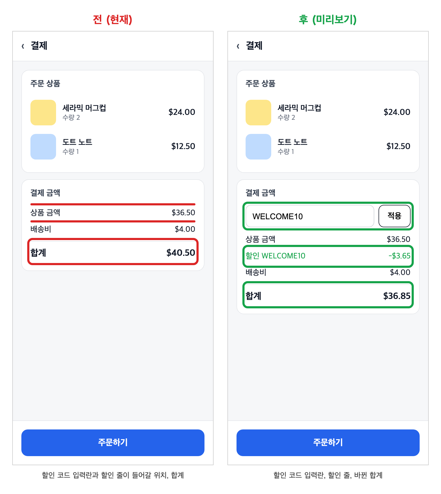
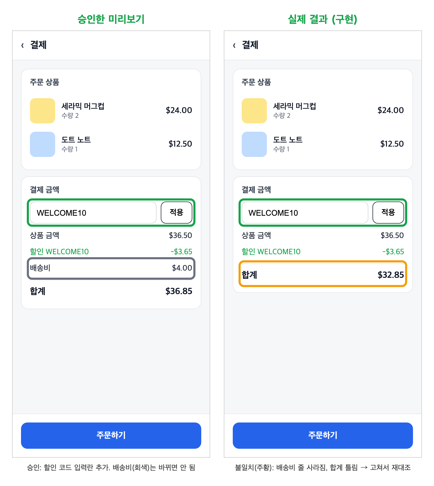
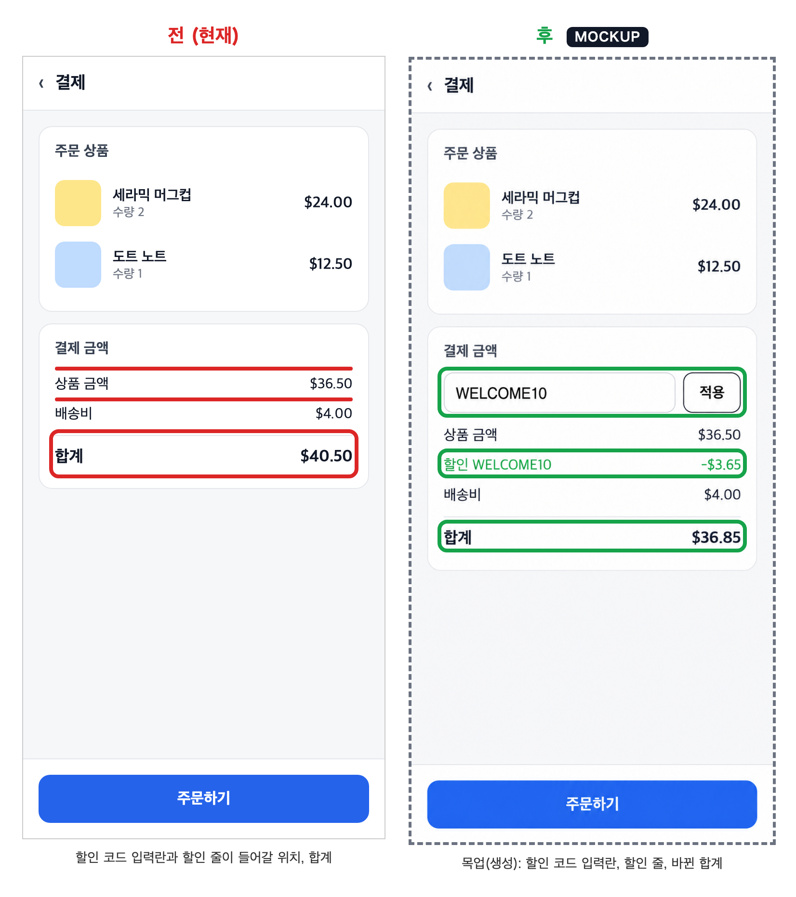

# ui-preview-gate

[English](README.md) | **한국어** | [日本語](README.ja.md)

화면 변경을 실제 전/후 이미지로 승인받게 하는 에이전트 스킬입니다.

AI 에이전트로 제품을 만들다 보면, 글만으로는 답을 알기 어려운 질문이 두 가지 있습니다.

- **"그래서 뭘 어떻게 바꿀 건데?"** - 코드를 쓰기 전에
- **"그래서 뭐가 어떻게 바뀐 건데?"** - "완료했습니다"라는 말을 들은 뒤에

긴 설명이나 diff만으로는 화면을 머릿속으로 상상해야 합니다. 이 스킬은 에이전트가
두 질문 모두에 그림으로 답하게 합니다. 만들기 전에 실제 화면 위에 변경을 보여 주고,
만든 뒤에는 결과가 승인한 내용과 같은지 증명하게 합니다.

대부분의 전/후 스킬은 변경이 끝난 뒤 기록(PR용 스크린샷)을 남깁니다. 이 스킬은
관문(gate)입니다. 미리보기를 구현 *전에* 승인받고, 결과를 구현 *후에* 그 승인안과
대조합니다.



## 4단계

1. **현재 확인** - 실행 중인 앱에서 지금 화면을 캡처하고 코드 위치(`file:line`)를
   적습니다. 기억에 의존해 제안하지 않습니다.
2. **미리보기와 승인** - 좌우로 나란히 놓은 이미지 한 장(전 **빨강**, 후 **초록**,
   기본은 모바일 375px)과 짧은 요약(어디에 생기는지, 무엇을 할 수 있게 되는지,
   바뀌지 않는 것, 영향받는 화면)을 보여 줍니다. 명시적인 OK를 받은 뒤에만 구현합니다.
3. **구현** - 승인된 미리보기대로 만듭니다. 눈에 보이게 달라지면 2단계로 돌아갑니다.
4. **결과 대조** - 같은 설정으로 다시 캡처해 승인안과 실제 결과를 비교합니다.
   약속한 변경은 초록으로 남고, 예상하지 못한 차이는 **주황** 상자로 표시합니다.



이 예시에서는 할인 코드 입력란은 들어갔지만, 바뀌면 안 되는 배송비 줄이 사라지고
합계가 틀렸습니다. 4단계가 "완료" 보고 전에 이를 잡아냅니다.

의도한 화면이 바뀌지 않는 버그 수정은 2단계를 건너뛰지만, 사용자가 볼 수 있는
차이가 있으면 전/후 이미지를 함께 보고합니다.

## 이미지 정책

기본값(`real-only`)에서는 양쪽 모두 실제 앱의 전체 화면 캡처여야 합니다. 잘라 낸 조각,
다시 그리거나 생성한 목업, 가짜 데이터는 쓰지 않습니다. 사용자나 프로젝트가
(예: AGENTS.md나 CLAUDE.md에서) `mockup-allowed`를 명시하면 목업을 쓸 수 있고,
목업 칸에는 이미지 안에 `MOCKUP` 표시가 붙습니다. 결과 대조(4단계)는 항상 실제
캡처를 씁니다.



`mockup-allowed`에서는 "후" 쪽을 디자인 목업으로 만들 수 있습니다(이 예시는 실제
캡처를 바탕으로 생성). "전" 쪽은 실제 캡처로 남으므로, 검토자는 바뀔 화면을 정확히
볼 수 있습니다.

## 설치

```bash
git clone https://github.com/leesunghyun/ui-preview-gate && cd ui-preview-gate
./install.sh --with-instructions   # Codex와 Claude Code
```

`--codex` 또는 `--claude`로 한쪽에만 설치할 수 있습니다. 여러 번 실행해도 안전합니다.

### `--with-instructions`가 필요한 이유

에이전트는 보통 턴마다 설명(description)을 보고 스킬을 고릅니다. 요청이 "이 화면을
바꿔 줘"로 시작하면 잘 동작하지만, 화면 아이디어는 고객 문의·조사·리뷰 대화 도중에
나오는 경우가 많고, 그때는 스킬이 쉽게 빠집니다. 결국 매번 스킬 이름을 직접 입력하게
됩니다. `--with-instructions`는 짧은 규칙
([ui-preview-gate/agent-instructions.md](ui-preview-gate/agent-instructions.md))을
`~/.codex/AGENTS.md`와 `~/.claude/CLAUDE.md`에 추가해, 부르지 않아도 에이전트가 매 턴
확인하게 합니다. 한 프로젝트에만 적용하려면 이 파일 내용을 해당 프로젝트의
`AGENTS.md` / `CLAUDE.md`에 붙여 넣으세요.

### 수동 설치

`ui-preview-gate/` 폴더를 에이전트의 스킬 디렉터리에 복사합니다.

```bash
# Codex
cp -R ui-preview-gate ~/.codex/skills/
# Claude Code
cp -R ui-preview-gate ~/.claude/skills/
```

그다음 `ui-preview-gate/agent-instructions.md`를 AGENTS.md / CLAUDE.md에 추가합니다
(위 설명 참고).

스크립트에는 Node 18 이상과 Playwright가 필요합니다.

```bash
npm i -D playwright && npx playwright install chromium
```

이미 설치된 Playwright를 쓰려면 `PLAYWRIGHT_MODULE`에 그 `playwright/index.mjs` 경로를 지정합니다.

## 스크립트

`scripts/capture.mjs`는 고정된 화면 크기로 페이지를 캡처하고, 상자로 바로 쓸 수 있는
요소 좌표를 출력합니다.

```bash
node ui-preview-gate/scripts/capture.mjs --url http://localhost:3000/checkout \
  --out before.png --width 375 --selector "#summary"
```

`scripts/compose.mjs`는 JSON 사양으로 좌우 비교 PNG 한 장을 만듭니다.

```bash
node ui-preview-gate/scripts/compose.mjs spec.json
```

사양 형식: [ui-preview-gate/references/compose-spec.md](ui-preview-gate/references/compose-spec.md)

## 예시 이미지 다시 만들기

```bash
for v in before after actual; do
  node ui-preview-gate/scripts/capture.mjs \
    --url "file://$PWD/examples/demo/checkout.html?v=$v&lang=ko" --out examples/out/ko/$v.png
done
node ui-preview-gate/scripts/compose.mjs examples/preview.ko.json
node ui-preview-gate/scripts/compose.mjs examples/verify.ko.json
```

## 라이선스

MIT
