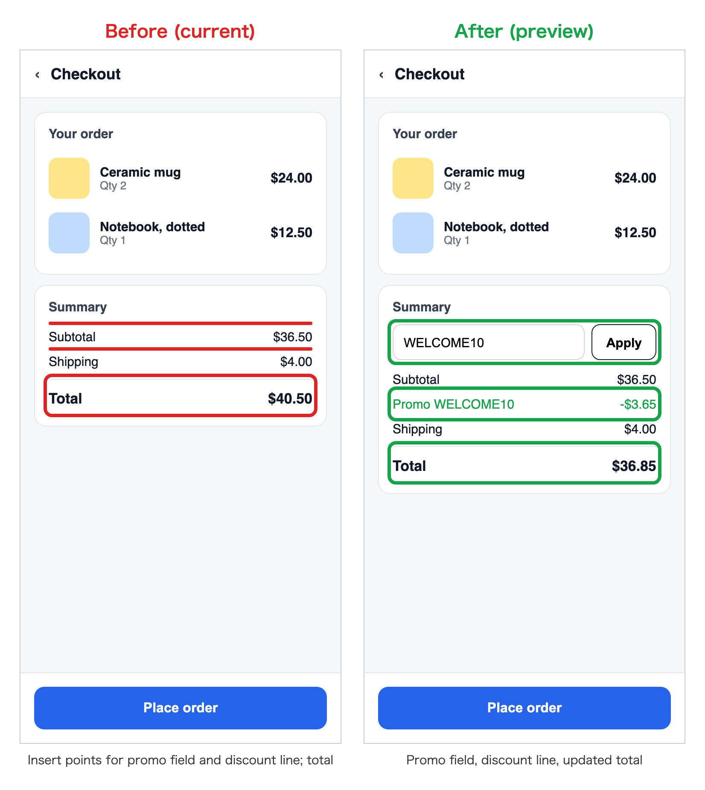
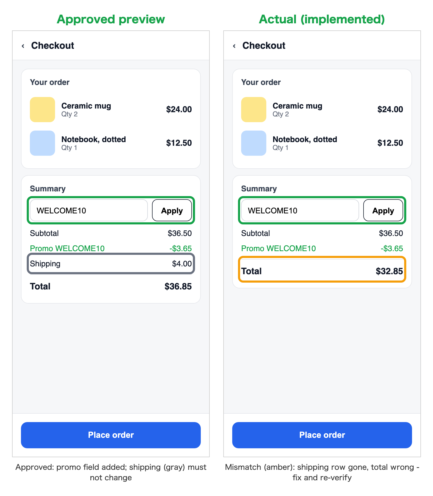
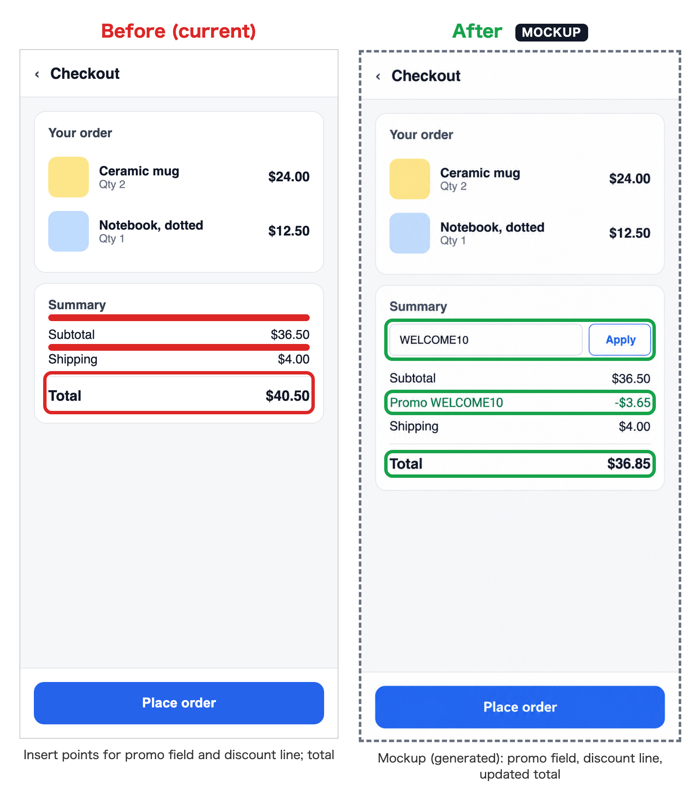

# ui-preview-gate

**English** | [한국어](README.ko.md) | [日本語](README.ja.md)

An agent skill that gates UI changes with real before/after images.

When you build a product with an AI agent, two questions are surprisingly hard
to answer from text alone:

- **"So what exactly are you going to change?"** - before it writes code
- **"So what exactly did you change?"** - after it says "done"

A paragraph of prose or a diff leaves you imagining the screen. This skill makes
the agent answer both questions with pictures: it shows the change on the real
screen before building it, then proves that what shipped matches what you
approved.

Most before/after skills document a change after it is made (screenshots for a
PR). This one is a gate: the preview is approved *before* implementation, and
the result is checked against that approval *after* it.



## The four phases

1. **Inspect** - capture the real current screen from a running app and cite the
   code (`file:line`). No proposals from memory.
2. **Preview and approve** - one side-by-side image (before **red**, after
   **green**, mobile 375px by default) plus a short summary: where it appears,
   what becomes possible, what does not change, which surfaces are affected.
   Implementation starts only after an explicit OK.
3. **Implement** - build to the approved preview. Visible deviations go back to
   phase 2.
4. **Verify** - re-capture with the same settings and compare the approved
   preview with the actual result. Promised changes stay green; unexpected
   differences are boxed **amber**.



In this example the promo field shipped, but the shipping row that was supposed
to stay unchanged disappeared and the total is wrong. Phase 4 catches it before
anyone reports "done".

Bug fixes that do not change the intended screen skip phase 2, but still report
before/after images if users can see a difference.

## Image policy

By default (`real-only`) both sides must be full-screen captures of the real
app - no cropped fragments, redrawn or generated mockups, or fake data. A user
or project can explicitly choose `mockup-allowed` (for example in AGENTS.md or
CLAUDE.md); mockup panels are then badged `MOCKUP` in the image. Verification
(phase 4) always uses a real capture.



Under `mockup-allowed` the "after" side can be a design mockup (here generated
from the real capture). The "before" side stays a real capture, so the reviewer
still sees the exact screen that will change.

## Install

```bash
git clone https://github.com/leesunghyun/ui-preview-gate && cd ui-preview-gate
./install.sh --with-instructions   # Codex and Claude Code
```

`--codex` or `--claude` limits it to one agent. Re-running is safe.

### Why `--with-instructions`

Agents pick skills from their description, usually per turn. That works when a
request starts as "change this screen", but UI ideas often appear halfway
through a support, research, or review conversation, and then the skill is
easily skipped - you end up typing its name every time.
`--with-instructions` adds a short rule
([ui-preview-gate/agent-instructions.md](ui-preview-gate/agent-instructions.md))
to `~/.codex/AGENTS.md` and `~/.claude/CLAUDE.md` so the agent re-checks every
turn without being asked. To scope it to one project, paste that file into the
project's `AGENTS.md` / `CLAUDE.md` instead.

### Manual install

Copy the `ui-preview-gate/` folder into your agent's skills directory:

```bash
# Codex
cp -R ui-preview-gate ~/.codex/skills/
# Claude Code
cp -R ui-preview-gate ~/.claude/skills/
```

Then add `ui-preview-gate/agent-instructions.md` to your AGENTS.md / CLAUDE.md
(see above).

The scripts need Node 18+ and Playwright:

```bash
npm i -D playwright && npx playwright install chromium
```

To reuse an existing install, set `PLAYWRIGHT_MODULE` to its `playwright/index.mjs`.

## Scripts

`scripts/capture.mjs` captures a page at a fixed viewport and prints element
rectangles you can paste as boxes:

```bash
node ui-preview-gate/scripts/capture.mjs --url http://localhost:3000/checkout \
  --out before.png --width 375 --selector "#summary"
```

`scripts/compose.mjs` turns a JSON spec into one side-by-side PNG:

```bash
node ui-preview-gate/scripts/compose.mjs spec.json
```

Spec format: [ui-preview-gate/references/compose-spec.md](ui-preview-gate/references/compose-spec.md).

## Regenerate the examples

```bash
for v in before after actual; do
  node ui-preview-gate/scripts/capture.mjs \
    --url "file://$PWD/examples/demo/checkout.html?v=$v" --out examples/out/$v.png
done
node ui-preview-gate/scripts/compose.mjs examples/preview.json
node ui-preview-gate/scripts/compose.mjs examples/verify.json
```

## License

MIT
